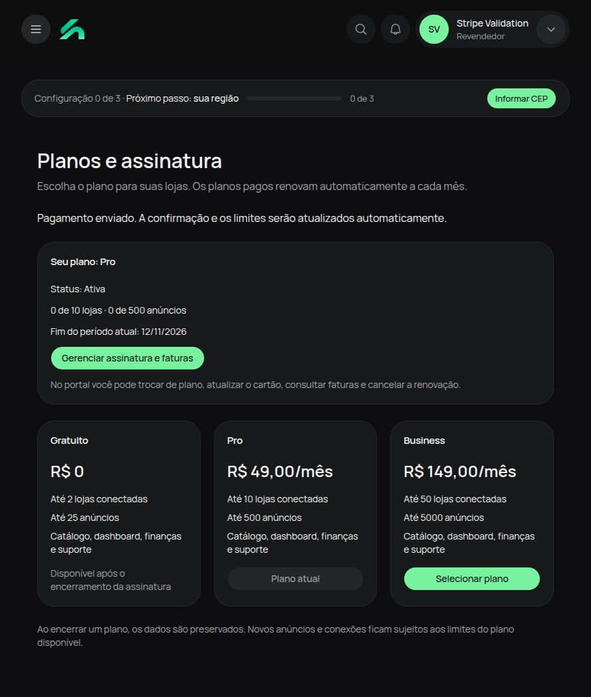
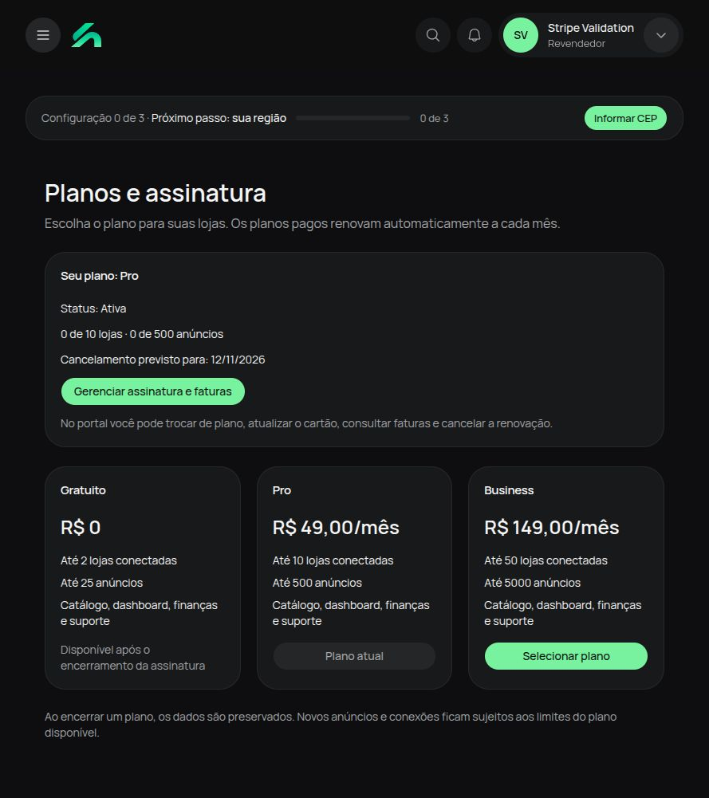
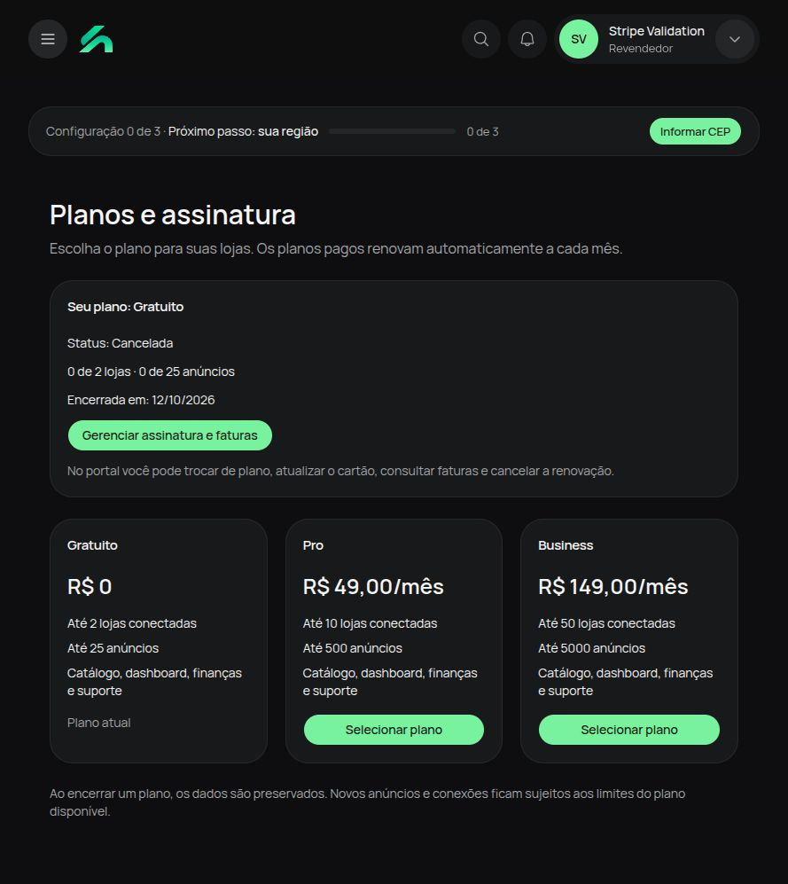
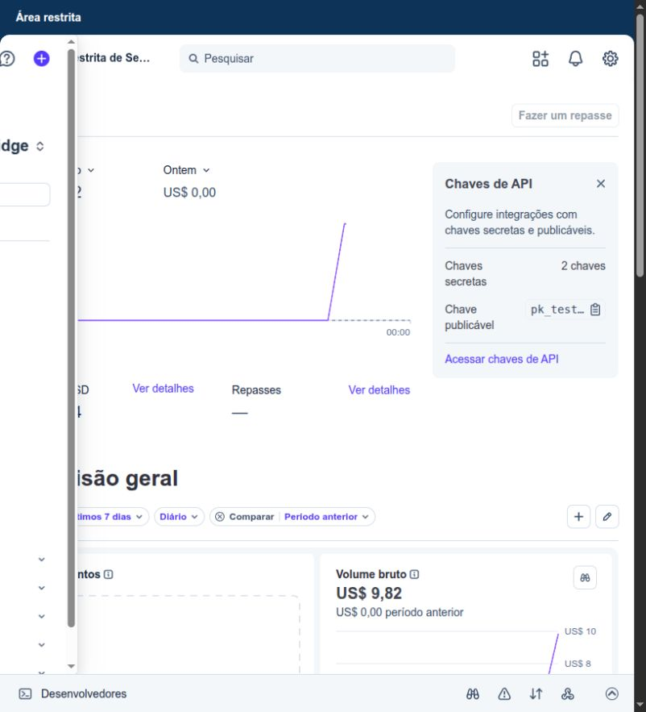

# Validação Stripe em modo de teste

Executada em 12/10/2026 no SellBridge local, em `http://localhost:3220`.
Todos os objetos Stripe utilizados têm `livemode=false`; nenhum pagamento real foi processado.

## Ambiente configurado

- Sandbox isolado: `acct_1UPlUHEmTTB17Xzf`.
- Pro de teste: R$ 49/mês, preço `price_1UPpAGEmTTB17XzfOqKF4G1u`.
- Business de teste: R$ 149/mês, preço `price_1UPpAGEmTTB17XzfjEk1p6so`.
- Portal específico: `bpc_1UPpAGEmTTB17XzfTA8KwUMW`, com cartão, faturas,
  troca de plano e cancelamento ao final do período.
- Credenciais locais salvas no `.env` ignorado pelo Git e no perfil do CLI
  `~/.config/stripe/sellbridge-test.toml`, com permissões restritas ao usuário.
- SDK Stripe 23.0.0 e CLI 1.53.1.
- Stripe Tax (`automatic_tax`) não foi ativado neste sandbox. A configuração fiscal
  de produção precisa de registros fiscais compatíveis antes de habilitar a coleta.

Em 12/10/2026, o ambiente foi reivindicado após login do proprietário e associado
à nova conta **SellBridge**, criada separadamente no painel Stripe.

- Conta SellBridge: `acct_1UPpRRIZeE3NXyWR`.
- Sandbox associado: **Área restrita de SellBridge**, `acct_1UPlUHEmTTB17Xzf`.
- Painel: https://dashboard.stripe.com/acct_1UPlUHEmTTB17Xzf/test/dashboard

Os produtos, preços, fatura e assinatura de teste foram preservados no mesmo sandbox.
A conta foi criada no Brasil, com cobrança online, assinaturas e faturas selecionadas.
A ativação de produção e a verificação empresarial ainda não foram realizadas.
As credenciais locais continuam apontando para o sandbox de teste da SellBridge.

## Fluxo verificado

| Etapa                 | Evidência e resultado                                                                                                                                                                                                                                       |
| --------------------- | ----------------------------------------------------------------------------------------------------------------------------------------------------------------------------------------------------------------------------------------------------------- |
| Login e planos        | Conta descartável local; preços de teste carregados diretamente do Stripe.                                                                                                                                                                                  |
| Contratação           | O botão do Pro abriu um Checkout hospedado em modo `subscription`.                                                                                                                                                                                          |
| Pagamento             | Cartão sintético `4242`, validade futura e CVC de teste; Checkout `cs_test_a1WptJQ1xDHmT6RCj55gLlHtzgpnPxvHnmCk7hzScbpgvXMmYhf5GGIaaW` ficou `complete` e `payment_status=paid`.                                                                            |
| Fatura                | `in_1UPpCmEmTTB17XzfUnfYqg1z`: `paid`, 4.900 centavos, BRL; visível no portal.                                                                                                                                                                              |
| Ativação              | Eventos reais assinados `invoice.paid` e `customer.subscription.created` retornaram HTTP 200; a UI mostrou Pro ativo, 10 lojas e 500 anúncios.                                                                                                              |
| Portal                | A gestão de assinatura abriu a configuração exclusiva do SellBridge, com histórico da fatura paga e opção de cancelamento.                                                                                                                                  |
| Cancelamento agendado | Confirmado pelo navegador no portal para 12/11/2026. O evento `customer.subscription.updated` retornou 200; a UI mostrou a data e preservou os limites Pro.                                                                                                 |
| Encerramento          | Após validar o agendamento, a assinatura descartável `sub_1UPpCnEmTTB17XzftTmUTxUX` foi encerrada imediatamente via API de teste para exercitar o estado terminal. O webhook atualizou o banco para `canceled` e a UI para Gratuito, 2 lojas e 25 anúncios. |

O encerramento imediato foi uma etapa adicional de teste; não se esperou até novembro
nem se avançou um test clock para a assinatura criada pelo Checkout. Renovação mensal,
cartão recusado, mudança real para Business e cálculo de tributos não foram exercitados
nesta validação de navegador.

A validação descobriu e corrigiu o uso de `cancel_at` pelo portal atual, mesmo quando
`cancel_at_period_end=false`. Também passou a considerar `ended_at` para exibir a
data real de encerramento. Há testes de regressão para ambos os casos, para eventos
de fatura paga/falha e confirmação de Checkout assíncrono.

## Execução local posterior

Antes de abrir o aplicativo, inicie o encaminhamento dos eventos:

```bash
pnpm billing:listen
pnpm dev
```

Use terminais separados. `billing:listen` encaminha para
`http://localhost:3000/api/webhooks/stripe`. O encaminhador precisa continuar ativo
para receber confirmações, cancelamentos e renovações em localhost. O segredo de
assinatura do listener está no `.env`; se o CLI emitir outro segredo ao recriar o
perfil, atualize a variável e reinicie o serviço web.

O PostgreSQL utilizado durante esta validação expõe a porta 5432; o `.env` original
apontava para 5433. O `.env` local foi ajustado para usar a porta disponível do PostgreSQL.

## Evidências visuais







## Verificações finais

- 244 testes da aplicação web passaram, incluindo 24 testes específicos de cobrança.
- Typecheck, lint dos arquivos alterados, Prettier, regra sem `else` e build de produção passaram.
- O servidor e o encaminhador temporários usados na validação foram encerrados ao final.

## Conta associada ao painel


